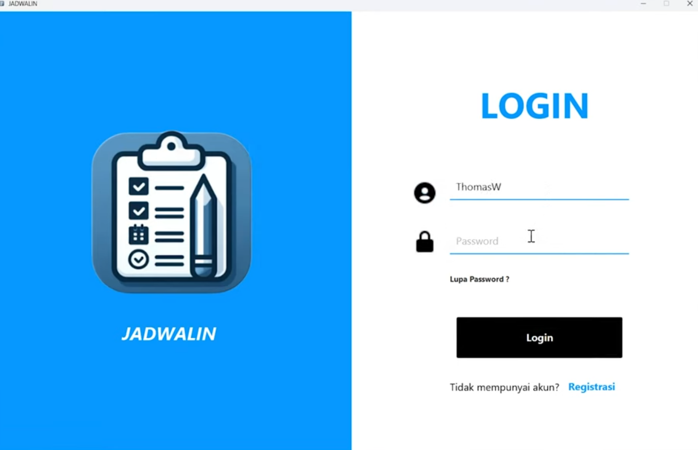

# JavaFX To-Do List Application

A desktop task management application built with JavaFX that helps users organize, track, and manage their daily activities through an intuitive graphical user interface.

## Demo Video

🎥 Watch the application in action:

https://www.youtube.com/watch?v=TjwQLu0oaN4

## Screenshot

  

## Features

- Create new tasks
- Edit existing tasks
- Delete tasks
- Mark tasks as completed
- User-friendly graphical interface
- Persistent data storage using a local database
- Desktop application built with JavaFX

## Team Members

| NIM | Name |
|------|------|
| 71230974 | Jimmy Christian |
| 71230975 | Thomas Aquinas Ryan Wisnu Adi |
| 71231002 | Philip Deric Kho |
| 71231050 | Samuel Natanael |

## Course Information

Developed as part of the Software Engineering (Rekayasa Perangkat Lunak) course.

**Instructor:**  
Budi Susanto, S.Kom., M.T.

## License

This project was developed for educational purposes.
